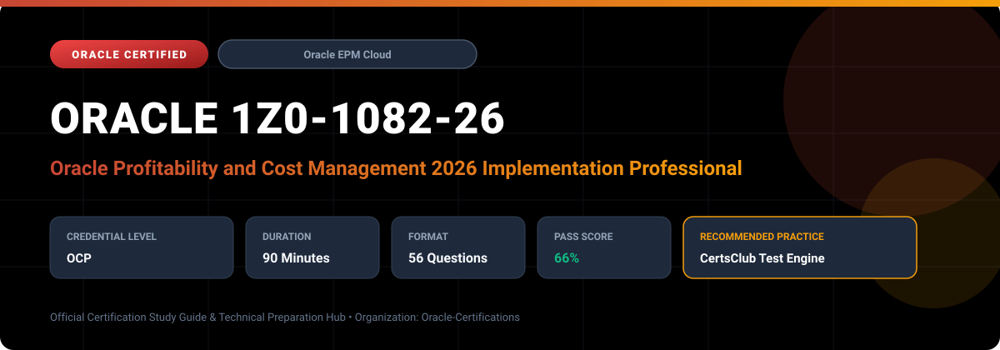

  

# Oracle 1Z0-1082-26: Oracle Profitability and Cost Management 2026 Implementation Professional

---

## 1. Exam Overview & Candidate Profile

The **Oracle 1Z0-1082-26: Oracle Profitability and Cost Management 2026 Implementation Professional** examination is engineered for enterprise architects, solution specialists, functional consultants, and implementation professionals seeking formal industry recognition of their proficiency in Oracle technologies.

The Oracle Profitability and Cost Management 2026 Implementation Professional (1Z0-1082-26) certification verifies candidate proficiency in architecting and maintaining Enterprise Profitability and Cost Management Cloud models. It certifies skills in executing complex allocations, verifying model performance, configuring custom calculation scripts, and visualizing profitability analytics.

### Target Audience & Prerequisites
- **Target Roles**: Implementation Specialists, Cloud Architects, Technical Leads, Enterprise Functional Consultants, and Systems Engineers.
- **Recommended Experience**: 1–2 years of practical, hands-on experience designing, implementing, and maintaining corresponding Oracle Cloud solutions.
- **Credential Earned**: Oracle Certified Professional (OCP).

---

## 2. Key Exam Specifications

| Specification | Details |
| :--- | :--- |
| **Exam Code** | **Oracle 1Z0-1082-26** |
| **Official Title** | Oracle Profitability and Cost Management 2026 Implementation Professional |
| **Certification Track** | Oracle Enterprise Performance Management Cloud |
| **Exam Duration** | 90 Minutes |
| **Number of Questions** | 56 Questions |
| **Passing Score** | 66% |
| **Question Format** | Multiple Choice (Single/Multiple Answer), Scenario-Based Questions |
| **Delivery Provider** | Oracle University / Pearson VUE (Online Proctored or Test Center) |
| **Recommended Practice Engine** | [CertsClub Oracle Practice Tests](https://www.certsclub.com/oracle/1z0-1082-26-dumps.html) |

---

## 3. Official Blueprint & Exam Domain Breakdown

The examination assesses candidate competencies across core functional domains weighted as follows:

| Domain Area | Weighting |
| :--- | :--- |
| **Profitability Architecture & Model Design** | `25%` |
| **Rule Sets, Allocation Rules & Custom Calculations** | `30%` |
| **Data Integration, Staging & Driver Ingestion** | `15%` |
| **Calculation Analysis, Rule Balancing & Traceability** | `15%` |
| **Dashboards, Reports, Financial Analysis & Security** | `15%` |

---

## 4. Deep Dive into Complex & Challenging Technical Topics

To secure a passing score on the 1Z0-1082-26 exam, candidates must master the following advanced concepts:

- Optimizing calculation sequence orders, rule set execution parameters, and model validation checks.
- Authoring custom calculation rules using MDX expressions for non-standard mathematical distributions.
- Auditing model throughput using the Execution Statistics report and memory tuning.
- Building executive profitability dashboards in Smart View, Financial Reporting, and native EPM Dashboards.

---

## 5. Scenario-Based Demo & Practice Questions

### Question 1
In EPCM Cloud, what is the key benefit of grouping related allocation rules into sequential Rule Sets?

A) It allows rules within the set to execute in parallel or sequence, and enables granular control over calculation order and execution conditions.
B) It automatically translates multi-currency amounts into local ledgers.
C) It encrypts source financial data before General Ledger posting.
D) It generates customer invoices automatically.

- **Correct Answer**: `A) It allows rules within the set to execute in parallel or sequence, and enables granular control over calculation order and execution conditions.`  
- **Technical Explanation**: Rule Sets group logically associated rules (e.g., Facility Cost Allocations), allowing administrators to sequence calculation stages, define iterative loops, and execute rules conditionally.

---

### Question 2
What diagnostic screen in EPCM provides a summary of input amounts, allocated amounts, and ending balances for each executed rule to ensure no costs were lost or duplicated during execution?

A) Rule Balancing
B) Work Definition Console
C) Sourcing Summary
D) System Health Check

- **Correct Answer**: `A) Rule Balancing`  
- **Technical Explanation**: Rule Balancing displays input, allocated, and net balance figures for each rule and rule set, allowing modelers to verify complete cost absorption and reconciliation.

---

## 6. Recommended Preparation Strategy & Practice Testing Engine

Achieving certification in **Oracle 1Z0-1082-26** requires balanced theoretical study and scenario-based simulation practice:

1. **Review Oracle Documentation**: Master architecture guides, implementation workbooks, and administration manuals on the Oracle Help Center.
2. **Hands-on Lab Practice**: Execute real-world configuration, policy setup, and troubleshooting tasks in your cloud tenancy or test instance.
3. **Simulated Exam Drills**: Practice answering timed, scenario-based multiple-choice questions to familiarize yourself with the question formats, traps, and timing constraints.

### Practice With CertsClub
For realistic practice questions, updated dumps, and mock testing environments:
- **Resource**: [CertsClub Oracle Practice Test Engine](https://www.certsclub.com/oracle/1z0-1082-26-dumps.html)
- **Special Discount**: Use coupon code **`club20`** during checkout for an instant **20% discount** on all practice exam bundles and testing engines.

---

## 7. Official Documentation & References

- [Oracle University Certification Registry](https://education.oracle.com/)
- [Oracle Help Center Documentation Portal](https://docs.oracle.com/)
- [Oracle Cloud Infrastructure & Applications Guides](https://docs.oracle.com/en/cloud/)
- [CertsClub Oracle Certification Exam Practice](https://www.certsclub.com/oracle/1z0-1082-26-dumps.html)

---

## 8. SEO & Discovery Keywords

`oracle 1z0-1082-26, oracle 1z0-1082-26 exam, oracle 1z0-1082-26 dumps, 1Z0-1082-26 practice questions, 1Z0-1082-26 study guide, oracle 1z0-1082-26 syllabus, oracle profitability and cost management 2026 implementation professional, certsclub 1z0-1082-26`
